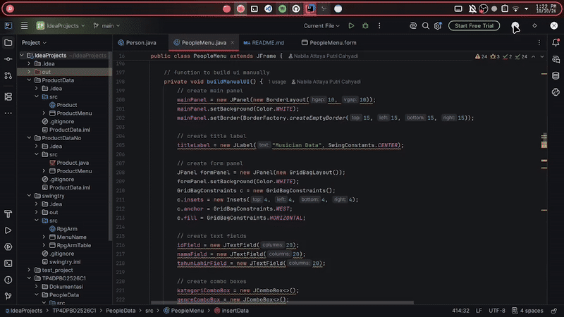
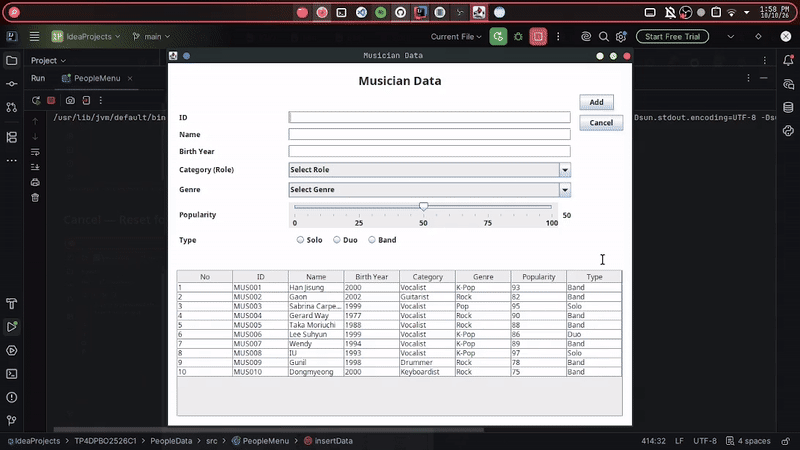
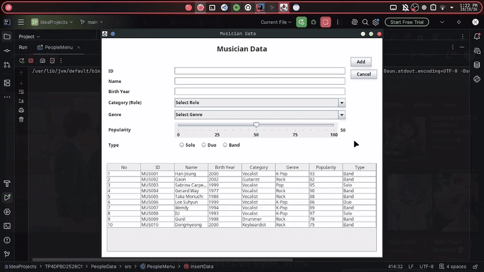
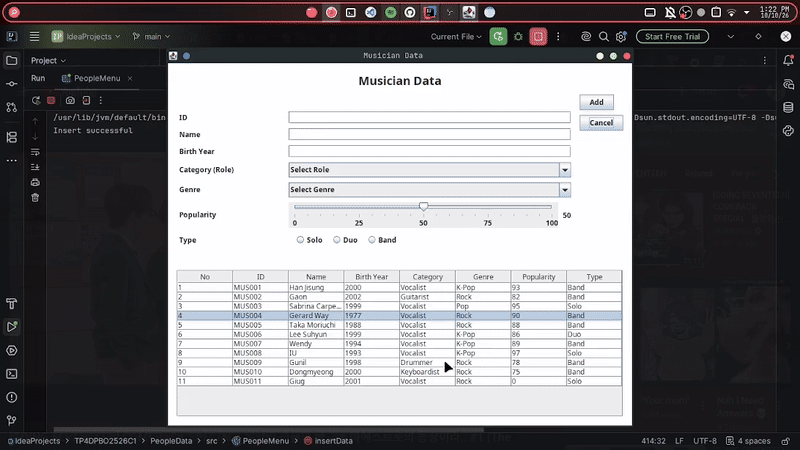
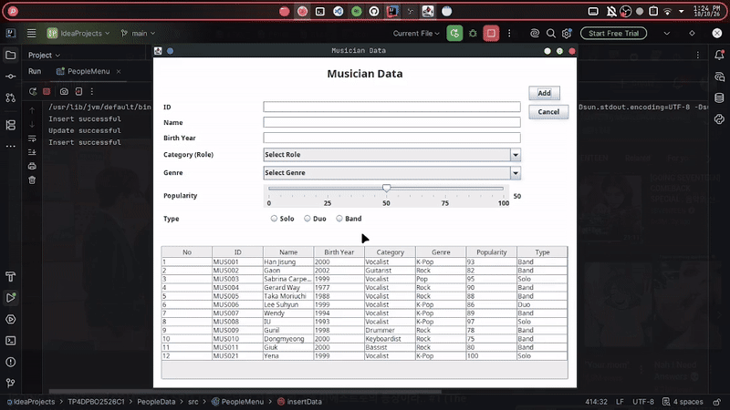
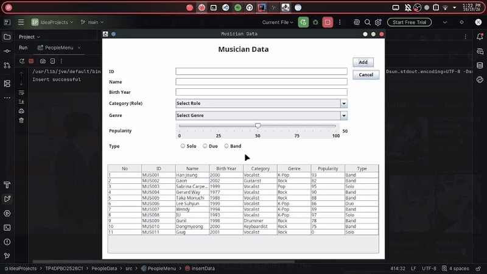
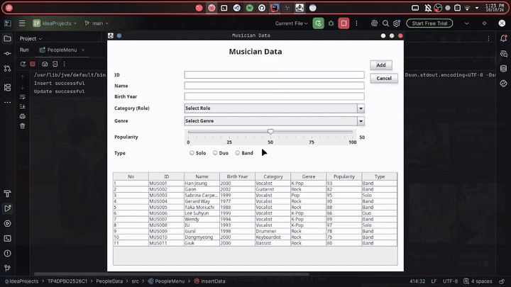

# TP 4 DPBO — PeopleData (Data Musisi)

Tugas Praktikum 4 Mata Kuliah **Desain dan Pemrograman Berorientasi Objek (DPBO)**.

Program ini mengelola data musisi (`People`) dengan GUI Java Swing, mengikuti pola `ProductData`: form input di atas, tabel data di bawah, dengan operasi CRUD penuh plus validasi dan dialog konfirmasi hapus.

## Janji

Saya Nabila Attaya Putri Cahyadi dengan NIM 2508355 mengerjakan Tugas Praktikum 4 pada Mata Kuliah Desain dan Pemrograman Berorientasi Objek (DPBO) untuk keberkahan-Nya maka saya tidak melakukan kecurangan seperti yang telah dispesifikasikan. Aamiin

## Struktur Folder

```text
TP4DPBO2526C1/
├── README.md
├── PeopleData/
│   ├── PeopleData.iml
│   └── src/
│       ├── Person.java
│       ├── PeopleMenu.java
│       └── PeopleMenu.form
└── Dokumentasi/
    ├── start.mp4 / start.gif
    ├── select.mp4 / select.gif
    ├── insert.mp4 / insert.gif
    ├── update.mp4 / update.gif
    ├── delete.mp4 / delete.gif
    ├── cancel.mp4 / cancel.gif
    └── error_handling.mp4 / error_handling.gif
```

## Desain / Fungsi Program

**Tema:** Data Musisi — setiap `Person` adalah satu musisi dengan 7 atribut.

**Atribut `Person.java` (`PeopleData/src/Person.java:2-10`):**

| # | Atribut | Tipe | Komponen GUI | Keterangan |
|---|---|---|---|---|
| 1 | ID | `String` | `JTextField` (`idField`) | Format `MUSXXX`, contoh `MUS001` |
| 2 | Nama | `String` | `JTextField` (`namaField`) | Contoh `IU` |
| 3 | Tahun Lahir | `int` | `JTextField` (`tahunLahirField`) | Angka `1900`–tahun berjalan |
| 4 | Kategori (Peran) | `String` | `JComboBox` (`kategoriComboBox`) | `Select Role, Vocalist, Guitarist, Bassist, Drummer, Keyboardist, DJ/Producer` |
| 5 | Genre | `String` | `JComboBox` (`genreComboBox`) | `Select Genre, Pop, Rock, Jazz, Classical, Hip-Hop, Dangdut, K-Pop, EDM` |
| 6 | Popularitas | `int` 0–100 | `JSlider` + `JLabel` (`popularitySlider`, `popularityValueLabel`) | `setMinimum(0)`, `setMaximum(100)`, `setMajorTickSpacing(25)`, `setMinorTickSpacing(5)`, label update realtime via `ChangeListener` |
| 7 | Tipe | `String` | `JRadioButton` x3 + `ButtonGroup` (`soloRadioButton`, `duoRadioButton`, `bandRadioButton`, `tipeButtonGroup`) | `Solo / Duo / Band` |

**File program:**

- `PeopleData/src/Person.java` — model data + getter/setter semua atribut.
- `PeopleData/src/PeopleMenu.java` — `JFrame` utama: `buildManualUI()`, CRUD (`insertData`, `updateData`, `deleteData`), `setTable()`, `populateList()`, `clearForm()`, semua listener.
- `PeopleData/src/PeopleMenu.form` — binding GUI Designer IntelliJ, mirror dari `buildManualUI()` agar program tetap jalan dengan `javac` biasa.

**Fungsi tiap komponen:**

- Form (`JTextField`/`JComboBox`/`JSlider`/`JRadioButton`) untuk input dan edit data.
- `addUpdateButton` berlabel `Add` saat `selectedIndex == -1`, berubah jadi `Update` setelah row diklik.
- `deleteButton` disembunyikan (`setVisible(false)`) saat mode Add, dimunculkan setelah row diklik.
- `cancelButton` memanggil `clearForm()` untuk reset form.
- `personTable` (`JTable` + `DefaultTableModel` dengan `isCellEditable=false`) untuk Read: klik row mengisi seluruh form via `mousePressed`.

## Method Program

| Method | Fungsi |
|---|---|
| `main` | Titik masuk: `SwingUtilities.invokeLater`, set `ContentPane`, judul `Musician Data`, ukuran `800x650`, `EXIT_ON_CLOSE`, tampilkan window. |
| `buildManualUI()` | Membangun seluruh UI manual (`BorderLayout` + `GridBagLayout`): title, form 7 baris, panel tombol vertikal, tabel + `JScrollPane`. |
| `populateList()` | Mengisi `listPerson` dengan 10 data awal `MUS001`–`MUS010`, reset `selectedIndex = -1`. |
| `setTable()` | Membuat `DefaultTableModel` read-only dengan kolom `No, ID, Name, Birth Year, Category, Genre, Popularity, Type`, mengisi dari `listPerson`. |
| `insertData()` | **Create:** ambil nilai form, validasi penuh, `listPerson.add(new Person(...))`, refresh tabel, `clearForm()`, dialog sukses. |
| `updateData()` | **Update:** cek `selectedIndex` valid, ambil + validasi nilai form (duplikat ID mengabaikan baris sendiri), `listPerson.get(selectedIndex).set...`, refresh tabel, `clearForm()`. |
| `deleteData()` | **Delete:** cek `selectedIndex` valid, `listPerson.remove(selectedIndex)`, refresh tabel, `clearForm()`. Dipanggil hanya setelah konfirmasi `YES_OPTION`. |
| `clearForm()` | Reset form: kosongkan text field, combo ke index 0, slider ke 50, `ButtonGroup.clearSelection()`, tombol kembali ke `Add`, sembunyikan Delete, `selectedIndex = -1`. |
| `getSelectedTipe()` / `setSelectedTipe(tipe)` | Baca radio yang dipilih (`Solo`/`Duo`/`Band`/`null`) dan set radio dari string tipe tabel. |
| Listener tombol + tabel | `Add/Update` bercabang via `selectedIndex`; `Delete` menampilkan `showConfirmDialog(YES_NO_OPTION)`; `Cancel` memanggil `clearForm()`; `mousePressed` pada tabel mengisi form + ubah mode ke Update; `ChangeListener` slider update label realtime. |

## Penjelasan Alur

1. Program jalan: constructor memanggil `buildManualUI()`, `listPerson = new ArrayList<>()`, `populateList()` mengisi 10 data, `setTable()` menampilkannya, combo/slider/radio diinisialisasi, `clearForm()` set mode Add.
2. **Read (tampilan awal):** tabel menampilkan 10 baris `MUS001`–`MUS010` (`No, ID, Name, Birth Year, Category, Genre, Popularity, Type`).
3. **Create:** isi form -> klik `Add` (`selectedIndex == -1`) -> `insertData()` validasi -> lolos: tambah ke list -> `setTable()` refresh -> `clearForm()` -> dialog `Data added successfully`.
4. **Select:** klik row tabel -> `mousePressed` set `selectedIndex = row` -> `idField`/`namaField`/`tahunLahirField`/`kategoriComboBox`/`genreComboBox` terisi, `popularitySlider.setValue(pop)`, `setSelectedTipe(...)` -> tombol jadi `Update`, tombol `Delete` muncul.
5. **Update:** edit form -> klik `Update` -> `updateData()` validasi -> lolos: `listPerson.get(selectedIndex)` di-set ulang -> `setTable()` -> `clearForm()` kembali ke mode Add -> dialog `Data updated successfully`.
6. **Delete:** klik row -> klik `Delete` -> `showConfirmDialog(Are you sure...?, YES_NO_OPTION)` -> `YES`: `deleteData()` hapus dari list -> `setTable()` -> `clearForm()` -> dialog sukses; `NO`: batal, data tetap.
7. **Cancel:** kapan saja klik `Cancel` -> `clearForm()`: field kosong, combo ke `Select Role`/`Select Genre`, slider 50, radio clear, tombol `Add`, Delete hidden, `selectedIndex = -1`.
8. **Slider:** setiap geser `popularitySlider` -> `ChangeListener` update `popularityValueLabel` realtime.
9. Data hanya tersimpan di `ArrayList` selama program berjalan.

## Validasi / Error Handling

| Bagian | Kondisi tidak valid | Penanganan |
|---|---|---|
| Field kosong | `ID` / `Name` / `Birth Year` kosong | `ERROR_MESSAGE`: `ID, Name, and Birth Year cannot be empty!` |
| Format ID | Tidak cocok `^MUS\d{3}$` | `ERROR_MESSAGE`: `ID must be in MUSXXX format! Example: MUS001.` |
| Duplikat ID | ID sama (case-insensitive) dengan data lain (Update mengabaikan baris sendiri) | `ERROR_MESSAGE`: `ID already exists! Use another ID.` |
| Nama | Panjang <2 (Insert) / <3 (Update) atau >50; mengandung selain huruf/spasi/`.'-` | `ERROR_MESSAGE`: `Name must be ...` / `Name can only contain letters, spaces, ., ' and -!` |
| Kategori | `kategoriComboBox.getSelectedIndex() <= 0` (`Select Role`) | `ERROR_MESSAGE`: `Please select a Category (Role)!` |
| Genre | `genreComboBox.getSelectedIndex() <= 0` (`Select Genre`) | `ERROR_MESSAGE`: `Please select a Genre!` |
| Tipe | Tidak ada radio dipilih (`getSelectedTipe() == null`) | `ERROR_MESSAGE`: `Please select a Type (Solo/Duo/Band)!` |
| Popularitas | `< 0` atau `> 100` | `ERROR_MESSAGE`: `Popularity must be between 0-100!` |
| Tahun Lahir | Bukan digit / bukan angka; `< 1900` atau `> tahun berjalan` | `ERROR_MESSAGE`: `Birth Year must be a number!` / `Birth Year must be between 1900-<currentYear>!` |
| Update/Delete tanpa seleksi | `selectedIndex` tidak valid | Dialog: `Select the data you want to update/delete.` |
| Delete | Klik `Delete` | `showConfirmDialog(..., YES_NO_OPTION, WARNING_MESSAGE)`; hapus hanya jika `YES_OPTION`. |

## Dokumentasi Saat Program Dijalankan

Semua operasi CRUD ditunjukkan di bawah (GIF agar langsung tampil di GitHub; file `.mp4` asli dengan nama sama tersedia di folder `Dokumentasi/`).

### Read — Tampilan awal + 10 data + klik row mengisi form





### Create — Insert data baru via tombol Add



### Update — Edit data terpilih via tombol Update



### Delete — Hapus data + confirmation prompt



### Cancel — Reset form via tombol Cancel



### Validasi — Error handling untuk input tidak valid


